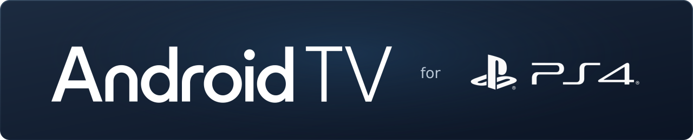

# Android TV 13 for PS4

Android TV 13 adapted for PlayStation 4, based on **BRTDTV's Android TV x86**.
PS4 adaptation and installer by Codey O'Connor.

[Status](#status) · [Source layout](#source-layout) · [Building](#building) · [Credits](#credits)

## Status

In development. This repository contains source code and development tooling.
No downloadable release or end-user installation guide has been published yet.

| Component | Current target |
| --- | --- |
| Android | Android TV 13 |
| Development console | PS4 CUH-1102A (Aeolia) |
| Installer source | `installer/sparse-v014` |
| Storage design | Compressed system image and sparse ext4 userdata within the existing PS4 user partition; no repartitioning |

Other console models are not confirmed by the testing recorded here.

## Source layout

| Path | Contents |
| --- | --- |
| [`installer/`](installer/README.md) | Native PS4 installer, interface and packaging scripts |
| `ramboot/` | Linux boot, Android startup and diagnostic tools |
| `patches/` | Kernel, graphics and quota patches |
| `probe/` | Console hardware probe |
| `branding/` | Icon and banner assets |

## Building

See [build dependencies and preparation](docs/BUILD.md).

The build scripts currently depend on development-machine paths, external
toolchains and prepared inputs. A clean clone is not yet a standalone build.
Android system images and compiled packages are not stored in Git.

## Credits

Thanks to **BRTDTV** for their work bringing Android TV to x86 PCs. This PS4
port builds on that foundation.

- [BRTDTV Telegram group](https://t.me/+7cbIufx3Eh5hZmYx)
- [New Telegram group](https://t.me/+t15cB5esYJUxZjdh)
- [TD Android TV no PC — YouTube](https://www.youtube.com/@TDAndroidTVnoPC)

See [asset attribution](docs/ASSETS.md) for branding sources and included font
licence information.
