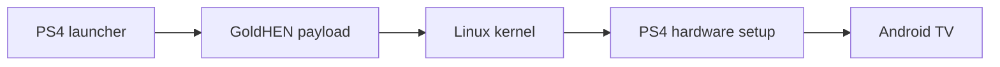

# Android TV for PS4

Android TV 13 on a PlayStation 4, based on **BRTDTV's Android TV x86** build. Install one PKG, open it from the home screen, and the console boots straight into Android TV from its internal drive. Your apps, accounts and settings are kept between launches.

[Download](https://github.com/odiecay/android-tv-ps4/releases/tag/v1.1) · [Installation](docs/INSTALL.md) · [Compatibility](docs/COMPATIBILITY.md) · [Hardware support](docs/HARDWARE.md) · [Release notes](docs/RELEASE-NOTES.md) · [How it works](docs/DEVELOPMENT.md) · [Build it](docs/BUILD.md) · [Contribute](CONTRIBUTING.md)

## What's new in 1.1

- **Runs on every GoldHEN firmware the Linux loader supports:** 5.05, 6.72, 7.00–7.55, 8.00–8.52, 9.00–9.60, 10.00–10.71, 11.00, 11.02, 11.50–11.52, 12.00–12.52 and 13.00–13.52.
- **No console model is blocked.** Slim, Pro and Baikal support is built in but untested. See [Hardware support](docs/HARDWARE.md).
- **More reliable video.** Some video, including YouTube and the NBA app, could freeze after a few seconds while the sound kept playing. That's fixed.
- **Controller works like a TV remote in every app.** X selects and Circle goes back everywhere. Before, a few apps ignored the controller on some screens, such as Kayo's sign-in button and going back in the NBA app.
- **Screensaver instead of sleep.** When idle, Android shows a screensaver and keeps running. Android's sleep mode froze PS4 Linux.
- **Named "PlayStation 4"** on your network and in casting apps, instead of a phone model name.
- **One 3.12 GB PKG** from Google Drive. No joining parts.
- **Failed starts explain themselves** and save their logs to a USB stick.

[Full release notes](docs/RELEASE-NOTES.md)

## Quick start

1. Download **Android-TV-for-PS4-1.1.pkg** from the [1.1 release page](https://github.com/odiecay/android-tv-ps4/releases/tag/v1.1) ([checksum and tips](docs/DOWNLOAD.md)).
2. Install it with GoldHEN's **Package Installer**, from an exFAT USB drive or over FTP.
3. Enable **GoldHEN → Servers → BinLoader** (port 9090).
4. Open **Android TV for PS4**.

**The first launch takes 5–10 minutes** while Android installs to the internal drive and sets itself up. Leave the console alone while progress or the Android animation is showing. After that, Android boots in about **2 minutes**.

To launch again later, load GoldHEN, make sure BinLoader is on, and open the app. The handover to Linux can take up to 2 minutes, so give it time. In Android, **Restart** takes you back to the PS4 system and **Shut down** turns the console off. Booting needs no PC or network.

**Updating from 1.0:** delete Android TV for PS4 from the PS4 home screen first, then install the 1.1 PKG and open it. Your Android apps, accounts and settings are stored separately in `/user/app/ps4-android`, so deleting the app doesn't remove them.

Android gets 32 GiB of storage. That isn't the download size: PS4 drive space is only used as Android fills it, and nothing is repartitioned.

## If it doesn't work

- **"BinLoader unavailable" (error 61):** close the app, turn BinLoader off and on again, and reopen it.
- **"Not enough free memory" (error 12):** restart the PS4, load GoldHEN and open the app before doing anything else.

For anything else, please report it, because failed starts are how other consoles get fixed:

1. **If Linux started but Android didn't**, plug a FAT32 or exFAT USB stick into the PS4. It can go in after the failure; the console keeps watching for one. The reports are saved to a folder called `AndroidTV-PS4-report-…`.
2. **If it stopped in the launcher**, copy the logs from `/user/app/ps4-android` with GoldHEN's FTP server.
3. Open a **[console report](https://github.com/odiecay/android-tv-ps4/issues/new?template=console-report.yml)** with your model, firmware and how far it got, and drag the logs (or a ZIP of the report folder) into the **Logs** box.

More fixes are in the [installation guide](docs/INSTALL.md#troubleshooting).

## What works

**YouTube, Spotify, VLC, Jellyfin, Kodi, Plex, TV Bro, BiglyBT, Crossy Road and AIDA64** come pre-installed, along with Google Play services and the Play Store. Sign in with your own accounts. [Exact app versions](docs/APPS.md).

Confirmed on the test console (fat CUH-1102A, firmware 13.52):

- HDMI picture and sound, and video playback in YouTube, Kodi, Kayo and the NBA app
- Wi-Fi, Ethernet and Bluetooth
- DualShock 4 and Google TV Streamer remote. The PS button goes Home, X selects and Circle goes back.
- Google sign-in, YouTube (signed in), and Spotify including Spotify Connect, where the console shows up as "PlayStation 4"
- Screensaver when idle, Restart to the PS4 system, and Shut down

Known limitations: this isn't a Google-certified device and there's no HDCP, so some protected streams won't play (7plus is one). YouTube needs you to sign in. The first Android setup may jump back to the start two or three times; keep going and it finishes. Details are in [Compatibility](docs/COMPATIBILITY.md#known-issues).

## Help wanted: other consoles

Every console can now try, but only a fat 13.52 console has been tested. If you have a different model or firmware, please give it a go and [send a console report](https://github.com/odiecay/android-tv-ps4/issues/new?template=console-report.yml), even if it fails. Anyone with PS4 Linux experience on Slim, Pro or Baikal hardware is especially welcome; [Hardware support](docs/HARDWARE.md) lists what's built and what still needs testing.

## How it works

The launcher installs Android to the internal drive, then hands a payload to GoldHEN, which loads Linux in place of the PS4 system. Linux unlocks the PS4's storage, sets up graphics, controllers and networking for this hardware, and starts Android. The PS4 system comes back when the console restarts.

The Android system image is read-only. PS4-specific changes are applied in memory at each boot, and your data lives in a separate image. The [architecture guide](docs/DEVELOPMENT.md) walks through the code, and [Storage](docs/STORAGE.md) explains disk usage.

## Development

The source is in [`releases/release-1.0/`](releases/release-1.0/): native launcher, modified kexec loader, boot runtime, tests and artwork. Start with the [build guide](docs/BUILD.md), then [Contributing](CONTRIBUTING.md) for areas that need work and how to report a test.

## Credits

- **BRTDTV / TD Android TV**: the Android TV x86 distribution this port is built on. [Channel](https://www.youtube.com/@TDAndroidTVnoPC) · [Community](https://t.me/+t15cB5esYJUxZjdh)
- **PS4 Linux contributors**: the PS4 kernel and [Linux loader](https://github.com/ps4-linux/ps4-linux-loader).
- **[GoldHEN](https://github.com/GoldHEN/GoldHEN)**: homebrew environment and payload loader.
- **OpenOrbis**, **Scene-Collective** and **sleirsgoevy**: PS4 toolchain, payload SDK and libjbc.
- **Ps3itaTeam**: the Liverpool raster configuration used in the graphics fix.
- **Android-x86, AOSP, Linux, Mesa** and the app developers.

[Full credits](docs/CREDITS.md) · [Artwork sources](docs/ASSETS.md). Android TV and PlayStation are trademarks of their respective owners. This is an independent homebrew project and is not affiliated with Google or Sony.
