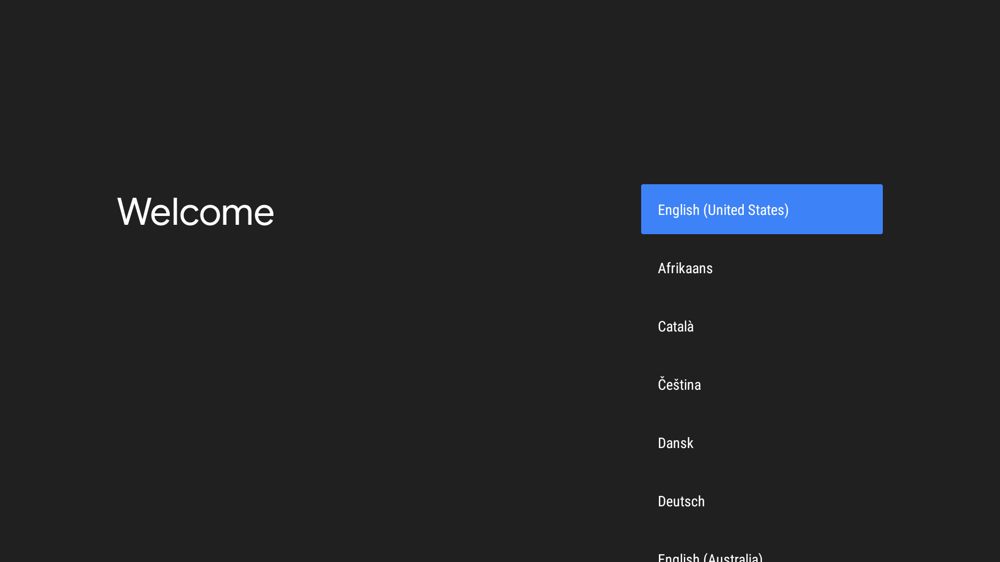
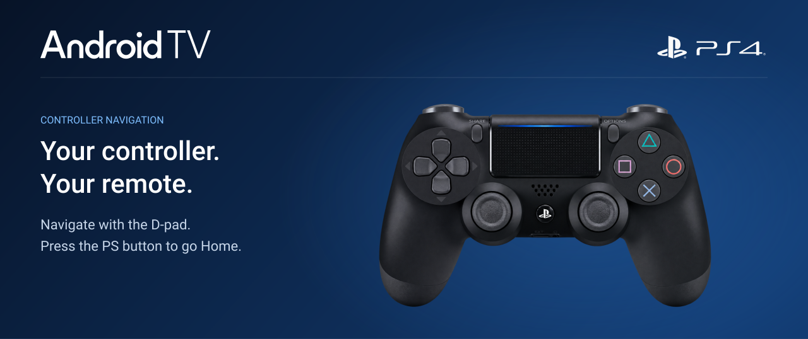

# Android TV 13 for PS4

A PS4 port of **BRTDTV's Android TV x86 builds**, installed and launched through
a PS4 app. It runs from the internal drive, with no PC needed after installation.
Android's files sit inside the existing PS4 filesystem. No repartitioning.

[Download](#download) · [Preview](#preview) · [Requirements](#requirements) · [Installation](#installation) · [Storage](#storage) · [Source](#source) · [Credits](#credits)

## Download

**v0.15 — Android TV 13, 32 GiB edition**

`Android-TV-PS4-13-v0.15-32GiB.pkg` · 2.35 GB

The PKG has not been uploaded to [GitHub Releases](https://github.com/odiecay/android-tv-ps4/releases) yet.

## Preview

*Installer artwork, revised since the last PKG build.*

## Requirements

- GoldHEN with BinLoader enabled on port **9090**.
- Allow about **42 GiB (45 GB) of drive space** to accommodate a full Android
  data image, the installed app, system files, a retained PKG download and free
  space. Initial use is smaller because the data image is sparse.
- Internet access for online setup and apps.

Test hardware: **CUH-1102A (Aeolia), firmware 13.52**. Other PS4 models and
firmware versions have not been tested.

v0.14 installed and booted on this console, with Ethernet working. v0.15 has
passed package checks but has not completed its console test.

## Installation

1. Load GoldHEN and enable BinLoader on port **9090**.
2. Install the PKG with the PS4 package installer.
3. Open **Android TV for PS4** from the home screen.
4. Leave it running while it copies the system and prepares the boot files.
   It then boots Linux, creates Android's data storage and starts Android TV.
5. Complete Android TV setup.

For later boots, load GoldHEN, enable BinLoader and open the app again.
It keeps your Android data and skips the installation. Restarting the console
returns to the PS4 operating system.

## Storage

The installer stores Android as files on the internal drive. It does not
create partitions or format the drive.

`system.sfs` is the compressed, read-only system. Linux mounts it, then mounts
the `system.img` inside it. Apps, settings and downloads go into `data.img`,
an ext4 filesystem that Linux mounts as a virtual disk.

The data image has a **32 GiB limit**, but it is sparse: it takes up physical
drive space as data is written, rather than reserving all 32 GiB at once.
Android and your PS4 games share the drive's free space. Formatting overhead
means Android reports slightly less than 32 GiB usable.

The 32 GiB is only the data image. System and boot files add about **2.17 GiB**,
and the installed launcher retains roughly **2.19 GiB** of package contents.
Together, a fully allocated installation is about **36.4 GiB (39 GB)**, before
filesystem overhead, logs and backups. Keeping the downloaded PKG on the
internal drive adds another **2.19 GiB**.

The installer's **2 GiB spare-space check is not the total space requirement**.
It does not reserve room for the data image to grow. See the
[storage breakdown](docs/STORAGE.md) for the calculation.

The PS4-specific changes to Android's system are applied at boot in a RAM
overlay. Apps and settings stay in the data image between boots. Uninstalling
the launcher PKG does not delete that image.

## Source

The current installer is in [`releases/v015`](releases/v015/).
Older versions are in [`installer/`](installer/README.md).

You can ask a coding agent to read the source and explain the parts you want
to understand. For example:

- [How does installation work?](releases/v015/source/install-prebuilt.c)
- [What happens if a copy is interrupted?](releases/v015/source/image-copy.c)
- [How does Android's restart request reach the console?](releases/v015/power/android-supervisor.c)

Have it point to the code it used. Check that it is reading the right version;
code alone does not prove a feature has been tested on hardware.

[Build instructions](docs/BUILD.md) list the required tools and external files.
Not every bundled component can be rebuilt from this checkout alone.

## Credits

Thanks to **BRTDTV** for their work bringing Android TV to x86 PCs. This PS4
port builds on that foundation.

- [BRTDTV Telegram group](https://t.me/+7cbIufx3Eh5hZmYx)
- [New Telegram group](https://t.me/+t15cB5esYJUxZjdh)
- [TD Android TV no PC — YouTube](https://www.youtube.com/@TDAndroidTVnoPC)

[Artwork sources and font licence](docs/ASSETS.md).
