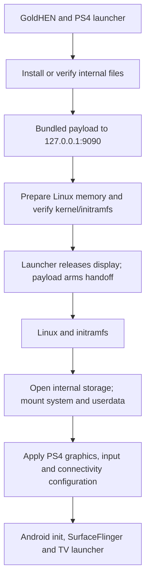

# Android TV for PS4

Android TV 13 running on PlayStation 4 hardware, based on **BRTDTV's Android TV x86** build. Install a PS4 PKG, open the launcher, and the console boots Linux and Android from its internal drive. Later launches keep your Android apps and settings.

The launcher installs files on the existing PS4 filesystem. It does not repartition the drive. Booting uses the console's own GoldHEN BinLoader through loopback; a PC, FTP server, router or internet connection is not part of the boot sequence. Android manages its own Wi-Fi and Ethernet once it starts.

[Installation](docs/INSTALL.md) · [How it works](docs/DEVELOPMENT.md) · [Build it](docs/BUILD.md) · [Contribute](CONTRIBUTING.md) · [Compatibility and testing](docs/COMPATIBILITY.md)

## Release

**1.0 · Android TV 13 · 32 GiB Android storage**

The current test package is `Android-TV-for-PS4.pkg`, approximately **2.98 GB**. The 32 GiB figure is Android's writable storage capacity, not the download size. Storage is allocated as it is used.

The package is undergoing console acceptance testing. Public binaries are distributed through the [Releases page](https://github.com/odiecay/android-tv-ps4/releases) when a build is accepted. [Compatibility and testing](docs/COMPATIBILITY.md) records the distinction between demonstrated features and acceptance of the complete package.

**Test hardware: CUH-1102A, Aeolia, firmware 13.52, with GoldHEN.** The current payload explicitly checks for firmware 13.52. Other console revisions and firmware versions need their own porting and validation work.

## Using it

1. Load GoldHEN and enable **Servers → BinLoader** on port **9090**.
2. Install the PKG using the PS4 package installer.
3. Open **Android TV for PS4**. The installer copies its bundled files, prepares Linux, and starts Android automatically.
4. Complete Android setup. Connect Wi-Fi or Ethernet for online services.

For subsequent boots, load GoldHEN, enable BinLoader and open the same launcher. Android's **Restart** returns to PS4 mode; **Shut down** is intended to power off the console. The bundled-app candidate's shutdown cleanup is being corrected before release acceptance.

If startup reports that BinLoader is unavailable: press **PS**, fully close Android TV, toggle **GoldHEN → Servers → BinLoader** off and on, then reopen Android TV. The completed installation is reused. See [installation and recovery](docs/INSTALL.md) for the full flow.

## What is included

The PKG carries the native installer, Linux loader and kernel, initramfs, compressed Android system, PS4 hardware adaptations and a separate read-only filesystem of bundled apps.

The current candidate includes **YouTube, Spotify, VLC, Jellyfin, Kodi, Plex, TV Bro, BiglyBT, Crossy Road and AIDA64**. Apps start with fresh data; services may require their own accounts. [App versions, architectures and sources](docs/APPS.md) identify the exact builds. YouTube and Crossy Road use ARM64 translation; the other apps use native x86/x86-64 code or Java. Native Google Play services is included to replace the base ARM-only service.

HDMI video and audio, Wi-Fi, Bluetooth pairing, the controller's Home action, and physical restart/shutdown have been demonstrated during development. Service-specific compatibility varies: this port does not establish Google device certification or HDCP support. In particular, 7plus protected playback has an unresolved HDCP limitation.

## Under the hood

Android uses the Linux kernel running directly on the console. Its init and services run inside Linux namespaces, with access to the actual GPU, display, sound and network hardware. The PS4 operating system is replaced for that boot; it returns when the console restarts.

The system image is read-only. A RAM overlay holds the PS4 adaptations, and an ext4 image holds persistent Android data. The [architecture guide](docs/DEVELOPMENT.md) follows the code through the handoff, display ownership, storage mounts, networking, Bluetooth and power control. [Storage](docs/STORAGE.md) explains sparse allocation and actual space requirements.

## Development

The active implementation is in [`releases/release-1.0/`](releases/release-1.0/). It includes the native launcher, modified kexec loader source, runtime adaptations, tests, artwork and input manifests. The packaged runtime scripts are published with hashes so their behaviour can be inspected directly.

Start with the [build guide](docs/BUILD.md). It distinguishes compiling the launcher and payload from rebuilding the complete Android distribution, and identifies required external binaries. [Contributing](CONTRIBUTING.md) maps areas for further work to their source files and explains how to report a useful console test.

## Credits

- **BRTDTV / TD Android TV** — the Android TV x86 distribution this port adapts. [Project channel](https://www.youtube.com/@TDAndroidTVnoPC), [community](https://t.me/+t15cB5esYJUxZjdh).
- **PS4 Linux contributors** — the PS4 kernel and Linux loader ecosystem. [PS4 Linux loader](https://github.com/ps4-linux/ps4-linux-loader).
- **GoldHEN** — homebrew environment and local payload receiver. [Project](https://github.com/GoldHEN/GoldHEN).
- **OpenOrbis**, **Scene-Collective**, and **sleirsgoevy** — PS4 toolchain, payload SDK and libjbc.
- **Ps3itaTeam** — published Liverpool raster configuration used to correct the Mesa adaptation.
- **Android-x86, AOSP, Linux, Mesa and the application authors** — the underlying operating system, drivers and apps.

[Component sources and licences](docs/CREDITS.md) · [Artwork and font sources](docs/ASSETS.md). Android TV and PlayStation are their respective owners' trademarks; this is an independent homebrew project.
