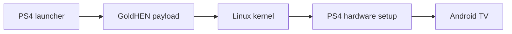

# Android TV for PS4

Android TV 13 on a PlayStation 4, based on **BRTDTV's Android TV x86** build. Install one PKG, open it from the home screen, and the console boots straight into Android TV from its internal drive. Your apps, accounts and settings are kept between launches.

[Download](https://github.com/odiecay/android-tv-ps4/releases/tag/v1.1) · [Installation](docs/INSTALL.md) · [Compatibility](docs/COMPATIBILITY.md) · [Hardware support](docs/HARDWARE.md) · [Release notes](docs/RELEASE-NOTES.md) · [Roadmap](docs/ROADMAP.md) · [How it works](docs/DEVELOPMENT.md) · [Build it](docs/BUILD.md) · [Contribute](CONTRIBUTING.md)

## What's new in 1.1

- **Support added for every GoldHEN firmware the Linux loader covers** (tested on 13.52 so far): 5.05, 6.72, 7.00–7.55, 8.00–8.52, 9.00–9.60, 10.00–10.71, 11.00, 11.02, 11.50–11.52, 12.00–12.52 and 13.00–13.52.
- **No console model is blocked.** Slim, Pro and Baikal support is built in but untested. See [Hardware support](docs/HARDWARE.md).
- **Fixes you'll notice:** video no longer freezes, the controller works like a TV remote in every app, a screensaver replaces the sleep mode that froze the console, and it shows up as "PlayStation 4" for Spotify Connect.
- **One 3.12 GB PKG** from Google Drive, and failed starts explain themselves and save their logs to a USB stick.

[Everything in 1.1](docs/RELEASE-NOTES.md)

## Quick start

1. Download **Android-TV-for-PS4-1.1.pkg** from the [1.1 release page](https://github.com/odiecay/android-tv-ps4/releases/tag/v1.1) ([checksum and tips](docs/DOWNLOAD.md)).
2. Install it with GoldHEN's **Package Installer**, from an exFAT USB drive or over FTP.
3. Enable **GoldHEN → Servers → BinLoader** (port 9090).
4. Open **Android TV for PS4**.

**The first launch takes 5–10 minutes** while Android installs to the internal drive and sets itself up. Leave the console alone while progress or the Android animation is showing. After that, Android boots in about **2 minutes**.

To launch again later, load GoldHEN, make sure BinLoader is on, and open the app. The handover to Linux usually takes 30 seconds to a minute, so give it time. In Android, **Restart** takes you back to the PS4 system and **Shut down** turns the console off. Booting needs no PC or network.

**Updating from 1.0:** delete Android TV for PS4 from the PS4 home screen first, then install the 1.1 PKG and open it. Your Android apps, accounts and settings are stored separately in `/user/app/ps4-android`, so deleting the app doesn't remove them.

Android gets 32 GiB of storage. That isn't the download size: PS4 drive space is only used as Android fills it, and nothing is repartitioned.

## If it doesn't work

- **"BinLoader unavailable" (error 61):** close the app, turn BinLoader off and on again, and reopen it.
- **"Restart your PS4, then open Android TV again" (code 12):** the PS4 ran short of free memory, usually on the first launch after installing or updating. Restart, load GoldHEN and open the app before doing anything else. Restarting straight after installing the PKG avoids it.

For anything else, please report it, because failed starts are how other consoles get fixed:

1. **If Linux started but Android didn't**, plug a FAT32 or exFAT USB stick into the PS4. It can go in after the failure; the console keeps watching for one. The reports are saved to a folder called `AndroidTV-PS4-report-…`.
2. **If it stopped in the launcher**, copy the logs from `/user/app/ps4-android` with GoldHEN's FTP server.
3. Open a **[console report](https://github.com/odiecay/android-tv-ps4/issues/new?template=console-report.yml)** with your model, firmware and how far it got, and drag the logs (or a ZIP of the report folder) into the **Logs** box.

More fixes are in the [installation guide](docs/INSTALL.md#troubleshooting).

## What works

**YouTube, Spotify, VLC, Jellyfin, Kodi, Plex, TV Bro, BiglyBT, Crossy Road and AIDA64** come pre-installed, along with Google Play services and the Play Store. Sign in with your own accounts. [Exact app versions](docs/APPS.md).

Confirmed on the test console (fat CUH-1102A, firmware 13.52):

- HDMI picture and sound, and video playback in YouTube, Kodi, Kayo, the NBA app and Spotify's music videos
- Wi-Fi, Ethernet and Bluetooth
- DualShock 4 and Google TV Streamer remote. The PS button goes Home, X selects and Circle goes back.
- Google sign-in, YouTube (signed in), and Spotify including Spotify Connect, where the console shows up as "PlayStation 4"
- Screensaver when idle, Restart to the PS4 system, and Shut down

Known limitations: this isn't a Google-certified device and there's no HDCP, so some protected streams won't play (7plus is one). YouTube needs you to sign in. Details are in [Compatibility](docs/COMPATIBILITY.md#known-issues).

## Still rough: help us test

These are the known weak spots in 1.1. Reports on any of them help the next release, and the [roadmap](docs/ROADMAP.md) has what's known about fixing each one.

- **The first launch after installing often needs a restart.** It stops with "Restart your PS4, then open Android TV again" (code 12). Copying a 3 GB PKG fragments the PS4's memory, and Linux needs two unbroken blocks of about 10–12 MB. A restart fixes it, though occasionally it takes two, a bit like running the exploit. The proper fix is reserving that memory before the copying starts, planned for the next release. Would you rather it restarted automatically? [Tell us](https://github.com/odiecay/android-tv-ps4/discussions).
- **Slim, Pro and Baikal are untested.** The support is built in, but no one has reported on it yet. Baikal is the most experimental, and its USB support is the biggest unknown. See [Hardware support](docs/HARDWARE.md).
- **Firmware other than 13.52 is untested.** The loader has offsets for 20 versions, but only 13.52 has been run.
- **MT7668 Wi-Fi** (many later Slims and Pros) is included but has never been run on real hardware.
- **Video is decoded on the CPU.** Drawing is GPU-accelerated (OpenGL ES 3.2 and Vulkan 1.1 through Mesa), but the GPU's hardware video decoder isn't used yet, so very high-bitrate 4K may struggle. Hooking it up through VA-API is the biggest playback upgrade available, and help from anyone who knows Mesa would be very welcome.
- **No HDCP,** so some protected streams won't play, and YouTube needs you to sign in.
- **First setup can jump back to the start,** usually once. Keep going and it finishes. 1.1 removed one cause; the other isn't known yet.
- **The handover to Linux** usually takes 30 seconds to a minute, longer on the first launch after installing or updating.

## Questions

**Can this damage my PS4, games or saves?** It doesn't touch them. Nothing is repartitioned or formatted: Android lives in one folder on the internal drive, and the PS4 system is unchanged.

**How do I get back to the PS4 system?** Choose **Restart** in Android. The console boots back into the PS4 system as normal; load GoldHEN again if you want to reopen Android TV.

**How do I remove it?** Delete the app from the home screen, then delete `/user/app/ps4-android` over FTP ([details](docs/INSTALL.md#removing-android)).

**Does it need a PC or internet to start?** No. The app hands Linux to GoldHEN on the console itself.

**Which consoles work?** Only a fat CUH-1102A on 13.52 has been tested so far. Everything else is built in and waiting on reports; see [Hardware support](docs/HARDWARE.md).

## Help wanted: other consoles

Every console can now try, but only a fat 13.52 console has been tested. If you have a different model or firmware, please give it a go and [send a console report](https://github.com/odiecay/android-tv-ps4/issues/new?template=console-report.yml), even if it fails. Anyone with PS4 Linux experience on Slim, Pro or Baikal hardware is especially welcome; [Hardware support](docs/HARDWARE.md) lists what's built and what still needs testing.

## How it works

The launcher installs Android to the internal drive, then hands a payload to GoldHEN, which loads Linux in place of the PS4 system. Linux unlocks the PS4's storage, sets up graphics, controllers and networking for this hardware, and starts Android. The PS4 system comes back when the console restarts.

The Android system image is read-only. PS4-specific changes are applied in memory at each boot, and your data lives in a separate image. The [architecture guide](docs/DEVELOPMENT.md) walks through the code, and [Storage](docs/STORAGE.md) explains disk usage.

## Development

The source is in [`releases/release-1.0/`](releases/release-1.0/): native launcher, modified kexec loader, boot runtime, tests and artwork. Start with the [build guide](docs/BUILD.md), then [Contributing](CONTRIBUTING.md) for areas that need work and how to report a test.

## Credits

- **BRTDTV / TD Android TV**: the Android TV x86 distribution this port is built on. [Channel](https://www.youtube.com/@TDAndroidTVnoPC) · [Community](https://t.me/+t15cB5esYJUxZjdh)
- **PS4 Linux contributors**: the PS4 kernel and [Linux loader](https://github.com/ps4-linux/ps4-linux-loader).
- **[GoldHEN](https://github.com/GoldHEN/GoldHEN)**: homebrew environment and payload loader.
- **OpenOrbis**, **Scene-Collective** and **sleirsgoevy**: PS4 toolchain, payload SDK and libjbc.
- **Ps3itaTeam**: the Liverpool raster configuration used in the graphics fix.
- **Android-x86, AOSP, Linux, Mesa** and the app developers.

[Full credits and artwork sources](docs/CREDITS.md). Android TV and PlayStation are trademarks of their respective owners. This is an independent homebrew project and is not affiliated with Google or Sony.
