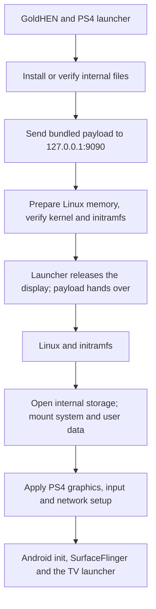

# Android TV for PS4

Android TV 13 on a PlayStation 4, based on **BRTDTV's Android TV x86** build. Install one PKG, open it from the home screen, and the console boots straight into Android TV from its internal drive. Your apps, accounts and settings are kept between launches.

[Download](https://github.com/odiecay/android-tv-ps4/releases/tag/v1.0) · [Installation](docs/INSTALL.md) · [Compatibility](docs/COMPATIBILITY.md) · [Release notes](docs/RELEASE-NOTES.md) · [How it works](docs/DEVELOPMENT.md) · [Build it](docs/BUILD.md) · [Contribute](CONTRIBUTING.md)

## Version 1.0

- **Android TV 13**, with 32 GiB of Android storage
- **3.11 GB** download, split into two parts for GitHub
- Tested on **CUH-1102A (Aeolia), firmware 13.52, with GoldHEN**

The 32 GiB is how much Android can store. It is not the download size, and space on the PS4 drive is only used as Android fills it. Nothing is repartitioned: Android lives in ordinary files on the existing PS4 filesystem.

Other PS4 models and firmware versions haven't been tested. The boot payload checks for firmware 13.52 and stops on anything else.

## Quick start

1. Download both `.pkg.part` files and the joining tool from the [release page](https://github.com/odiecay/android-tv-ps4/releases/tag/v1.0). On Windows, double-click **Join-PKG-Windows.cmd**. On Linux or macOS, run `sh join-pkg.sh`. Either tool rebuilds and verifies `Android-TV-for-PS4.pkg` ([details](docs/DOWNLOAD.md)).
2. Copy the PKG to an exFAT USB drive and install it with GoldHEN's **Package Installer**.
3. Enable **GoldHEN → Servers → BinLoader** (port 9090).
4. Open **Android TV for PS4**.

**The first launch takes 5–10 minutes** while Android is installed to the internal drive and set up. Leave the console alone while progress or the Android animation is showing. After that, Android boots in about **2 minutes**.

To launch again later, load GoldHEN, make sure BinLoader is on, and open the app. In Android, **Restart** takes you back to the PS4 system and **Shut down** turns the console off.

Booting needs no PC, network or internet connection. The app hands its payload to GoldHEN on the console itself. Once Android is running, it manages Wi-Fi and Ethernet on its own.

If the launcher reports that BinLoader is unavailable, close the app, turn BinLoader off and on again, and reopen it. More fixes are in the [installation guide](docs/INSTALL.md#troubleshooting).

## What's included

**YouTube, Spotify, VLC, Jellyfin, Kodi, Plex, TV Bro, BiglyBT, Crossy Road and AIDA64** come pre-installed, along with Google Play services and the Play Store. Sign in with your own accounts. [Exact app versions](docs/APPS.md).

Working on the test console:

- HDMI picture and sound
- Wi-Fi, Ethernet and Bluetooth
- DualShock 4 and Google TV Streamer remote; the PS button goes to Home
- Google sign-in, YouTube playback (signed in) and Kayo streaming
- Restart to PS4 mode and power-off from Android

Known limitations: this isn't a Google-certified device, and there is no HDCP. Some protected streams won't play (7plus is one), and YouTube needs you to sign in. Details are in [Compatibility](docs/COMPATIBILITY.md#known-issues).

## How it works

Android runs on a Linux kernel booted directly on the console, with full access to the GPU, display, audio and network hardware. The PS4 system comes back when the console restarts.

The Android system image is read-only. PS4-specific changes are applied in memory at each boot, and your data lives in a separate ext4 image. The [architecture guide](docs/DEVELOPMENT.md) walks through the code, and [Storage](docs/STORAGE.md) explains disk usage.

## Development

The source is in [`releases/release-1.0/`](releases/release-1.0/): native launcher, modified kexec loader, boot runtime, tests and artwork. Start with the [build guide](docs/BUILD.md), then [Contributing](CONTRIBUTING.md) for areas that need work and how to report a test.

## Credits

- **BRTDTV / TD Android TV**: the Android TV x86 distribution this port is built on. [Channel](https://www.youtube.com/@TDAndroidTVnoPC) · [Community](https://t.me/+t15cB5esYJUxZjdh)
- **PS4 Linux contributors**: the PS4 kernel and [Linux loader](https://github.com/ps4-linux/ps4-linux-loader).
- **[GoldHEN](https://github.com/GoldHEN/GoldHEN)**: homebrew environment and payload loader.
- **OpenOrbis**, **Scene-Collective** and **sleirsgoevy**: PS4 toolchain, payload SDK and libjbc.
- **Ps3itaTeam**: the Liverpool raster configuration used in the graphics fix.
- **Android-x86, AOSP, Linux, Mesa** and the app developers.

[Full credits](docs/CREDITS.md) · [Artwork sources](docs/ASSETS.md). Android TV and PlayStation are trademarks of their respective owners. This is an independent homebrew project and is not affiliated with Google or Sony.
