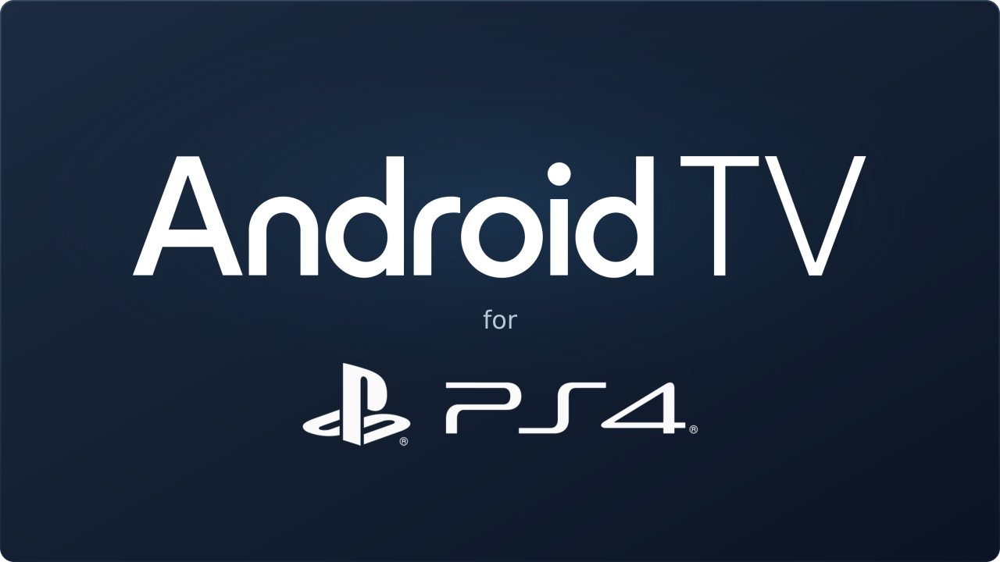

# Android TV 13 for PS4

Android TV 13 on PlayStation 4, by Codey O'Connor.

This project grew out of building Android TV x86 media boxes and experimenting
with Linux on PS4. Wanting Kayo Sports on the console brought those two projects
together. Newer Android TV versions are on the horizon, pending testing.

## Based on BRTDTV

This project is based on **BRTDTV's Android TV x86 work**. Their builds were
what I used for my Intel PC media boxes and provided the Android TV foundation
for this PS4 project. Credit to BRTDTV for that work; this repository contains
my PS4 adaptation, installer and supporting development tools.

- [BRTDTV on Telegram](https://t.me/brtdtv)
- [Android TV x86 BR release channel](https://t.me/Android_roms_x86)
- [TD Android TV no PC on YouTube](https://www.youtube.com/@TDAndroidTVnoPC)
- [BRTDTV community FAQ](https://brtdtvfaqs.page.gd/)

## Development

This repository contains the installer source, Linux boot tooling, graphics and
kernel patches, and selected branding. Development is ongoing. The latest
installer source included here is `installer/sparse-v014`.

The current installer design uses a compressed Android system image and creates
sparse ext4 userdata inside the existing PS4 user partition, without
repartitioning. The development hardware is a CUH-1102A (Aeolia).

Source availability is not a claim that every installer revision has completed
console testing. Installation instructions and downloadable releases will be
added as that work is completed.

## Repository guide

| Path | Contents |
| --- | --- |
| `installer/` | Installer iterations, native interface and packaging scripts |
| `ramboot/` | Linux boot, Android startup and diagnostic tooling |
| `patches/` | Kernel, graphics and quota adaptations |
| `probe/` | Console hardware probe source |
| `branding/` | Selected v6 icon/banner artwork and its source assets |
| `docs/BUILD.md` | Current build dependencies and preparation requirements |
| `docs/ASSETS.md` | Included assets and attribution records |
| `release-notes.txt` | Unfinished working notes for the release post |

## Build status

The existing build scripts still use development-machine paths and prepared
inputs. See [the build notes](docs/BUILD.md) before attempting a build. This
checkout does not yet provide a self-contained, clean-machine build.

## AI in development

I used AI throughout development to help build, test and refine Android TV 13
on PS4. It extended what I could do with my experience and ideas. I'm sharing
it because I'm happy with what I've built and want other people to enjoy it too.
