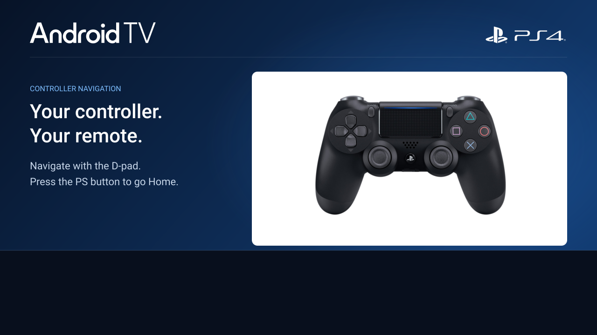

# Android TV 13 for PS4

Install Android TV on your PS4's internal drive with a native PS4 installer.
Based on **BRTDTV's Android TV x86 builds**, with PS4-specific hardware support
and **32 GiB of Android storage—without repartitioning your drive**.

Once installed, launch it from the PS4 home screen with GoldHEN and BinLoader
enabled. No PC or NAS is needed to run it.

[Download](#download) · [Preview](#preview) · [Requirements](#requirements) · [Installation](#installation) · [Storage](#how-storage-works) · [Source](#exploring-the-source) · [Credits](#credits)

## Download

**v0.15 · Android TV 13 · 32 GiB edition**  
Package: `Android-TV-PS4-13-v0.15-32GiB.pkg` · approximately 2.35 GB

[GitHub Releases](https://github.com/odiecay/android-tv-ps4/releases)

The package is prepared locally; it has not been uploaded to GitHub Releases.

## Preview

*Android TV's first-run setup from the development console.*

*Controller preview artwork for the native installer. Progress and status are
rendered separately while installation runs; this image shows the artwork.*

## Requirements

- A compatible PS4 running GoldHEN, with **BinLoader enabled on port 9090**.
- Free internal storage for the Android system, a 2 GiB margin, and the Android
  apps and files you plan to add.
- An internet connection for online setup and apps.

The development console is a **CUH-1102A (Aeolia), firmware 13.52**. v0.14
installed and booted independently on that console with Ethernet connectivity.
v0.15 adds installer recovery, revised previews and Android-to-console power
handling; its full console acceptance test is not recorded as complete.
Other hardware revisions and firmware combinations are unverified.

## Installation

1. Install the PKG using the PS4 package installer.
2. Load GoldHEN and enable BinLoader on port **9090**.
3. Open **Android TV for PS4** from the home screen. The app copies Android
   and its boot files to the internal drive, showing progress as it works.
4. The installer launches Linux automatically. On first boot, Linux creates
   Android's writable storage and starts Android TV.
5. Complete Android TV setup, then install the apps you want to use.

Keep the console powered on during installation and first boot.

To use Android again, load GoldHEN, enable BinLoader and open the app. It
reuses the existing installation and your Android data rather than copying the
system again. Restarting the physical console returns to the PS4 operating system.

## How storage works

Android lives inside the PS4's existing filesystem. The installer does not
create partitions or reformat the drive.

The system is stored in a compressed, read-only image (`system.sfs`). Linux
mounts it, then mounts the `system.img` filesystem inside. Apps, settings and
downloads live separately in `data.img`: a file formatted as ext4 and mounted
as a virtual disk.

That virtual disk has a **32 GiB capacity**. It is a **sparse file**, so empty
space inside it does not consume the full amount of physical storage upfront.
As Android writes data, the file occupies more of the PS4 drive's shared free
space. The capacity is not reserved space, and filesystem overhead reduces the
usable amount Android reports.

PS4-specific system changes are applied at boot through a temporary in-memory
overlay. Your Android data stays on disk independently of that overlay.
Removing the launcher PKG does not remove the separate Android data image.

## Exploring the source

Curious how it works? You can use a coding agent to explore the source and ask
questions in your own terms. Ask it to show the files behind its explanation,
and follow up on whatever interests you.

- “Walk me through a first installation.” — [Installer flow](releases/v015/source/install-prebuilt.c)
- “What happens if copying is interrupted?” — [Copy and resume logic](releases/v015/source/image-copy.c)
- “How does Android restart the PS4?” — [Power-control supervisor](releases/v015/power/android-supervisor.c)

Start with [`releases/v015`](releases/v015/) for this release. Earlier installer
iterations remain under [`installer/`](installer/README.md). Ask the agent to
use the right version, distinguish implementation from tested behaviour, and
identify any missing source needed to answer your question.

For dependencies and build commands, see the [build guide](docs/BUILD.md).
The build requires external toolchains and prepared binary inputs; this
checkout is not a self-contained build of every bundled component.

## Credits

Thanks to **BRTDTV** for their work bringing Android TV to x86 PCs. This PS4
port builds on that foundation.

- [BRTDTV Telegram group](https://t.me/+7cbIufx3Eh5hZmYx)
- [New Telegram group](https://t.me/+t15cB5esYJUxZjdh)
- [TD Android TV no PC — YouTube](https://www.youtube.com/@TDAndroidTVnoPC)

[Artwork sources and font licence](docs/ASSETS.md).
